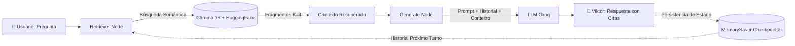

# 🧭 Viktor — Agente RAG en Existencialismo, Logoterapia y Humanismo


-yellow)


> Un agente conversacional inteligente dotado de **memoria persistente** y **recuperación aumentada por generación (RAG)**, diseñado para reflexionar pedagógicamente sobre la libertad, la angustia, el absurdo y la búsqueda de sentido en la vida humana.

---

## 📖 Descripción del Proyecto

**Viktor** es un asistente de IA inspirado en el pensamiento de Viktor Frankl, Jean-Paul Sartre y Albert Camus. Su propósito es responder preguntas complejas sobre el **existencialismo**, la **logoterapia** y la **psicología humanista**, fundamentando todas sus explicaciones en fuentes documentales reales y citando textualmente las obras de referencia.

### 🎯 Características Principales
* 📚 **RAG Preciso y Fundamentado**: Recupera fragmentos contextuales desde una base de datos vectorial local para evitar alucinaciones.
* 🧠 **Memoria Conversacional con LangGraph**: Mantiene el contexto histórico del diálogo entre turnos gracias a un *checkpointer* (`MemorySaver`) indexado por `thread_id`.
* ⚡ **Inferencia Ultrarrápida con Groq**: Utiliza modelos de código abierto de gran escala (`openai/gpt-oss-120b` o familia Llama 3) sobre LPUs de alto rendimiento.
* 🛡️ **Control de Tasa de Peticiones (Rate Limit)**: Algoritmo con reintentos y *backoff exponencial* que absorbe los picos de uso (error 429) de la API de Groq sin interrumpir la conversación.
* 🕊️ **Diseño Ético del Prompt**: Incorpora pautas deontológicas explícitas: el asistente aclara que no sustituye el apoyo terapéutico profesional y responde con empatía y recursos de ayuda si detecta sufrimiento agudo.

---

## 🏗️ Arquitectura del Sistema

El flujo de trabajo está orquestado mediante un grafo de estados cíclico con **LangGraph**:



1. **Carga y Fragmentación**: Los PDFs se procesan con `PyPDFLoader` y se dividen en fragmentos de 1000 caracteres con 150 caracteres de solapamiento (`RecursiveCharacterTextSplitter`).
2. **Embeddings Locales**: Se indexan con `sentence-transformers/all-MiniLM-L6-v2` de HuggingFace (sin consumo de cuota de API).
3. **Almacenamiento Vectorial**: Persistencia local en **ChromaDB**.
4. **Ciclo del Grafo**:
   * **Nodo `retrieve`**: Busca los 4 fragmentos más relevantes para la consulta del usuario.
   * **Nodo `generate`**: Ensambla el *System Prompt*, el historial previo de mensajes y los fragmentos recuperados para invocar el LLM de Groq.
   * **Memoria**: `MemorySaver` asocia la sesión a un `thread_id` único, permitiendo preguntas de seguimiento (ej: *"¿Y qué opinaba él sobre el sufrimiento?"* reconociendo el sujeto anterior).

---

## 📚 Base Documental (Corpus)

El conocimiento documental de Viktor está compuesto por textos fundamentales ubicados en `documentos_filosofia/`:

| Obra | Autor | Temas Clave |
| :--- | :--- | :--- |
| *El existencialismo es un humanismo* | Jean-Paul Sartre | La existencia precede a la esencia, angustia, condena a la libertad, responsabilidad humana. |
| *El hombre en busca de sentido* | Viktor Frankl | Voluntad de sentido, resiliencia en situaciones límite, autotrascendencia, la tríada trágica. |
| *El mito de Sísifo* | Albert Camus | El sentimiento del absurdo, la rebelión lúcida, la confrontación del ser humano frente al silencio del mundo. |

---

## 🚀 Instalación y Puesta en Marcha

### 1. Clonar el Repositorio
```bash
git clone https://github.com/TU_USUARIO/TU_REPOSITORIO.git
cd TU_REPOSITORIO
```

### 2. Crear un Entorno Virtual y Activar
```bash
# En Windows:
python -m venv .venv
.venv\Scripts\activate

# En macOS / Linux:
python3 -m venv .venv
source .venv/bin/activate
```

### 3. Instalar Dependencias
```bash
pip install -r requirements.txt
```

### 4. Configurar Variables de Entorno
Crea un archivo `.env` en la raíz del proyecto a partir de la plantilla:
```bash
cp .env.example .env
```
Edita `.env` e introduce tu API Key gratuita de [Groq Console](https://console.groq.com/keys):
```env
GROQ_API_KEY=gsk_tu_clave_aqui
```

### 5. Ejecutar el Notebook
Abre Jupyter Notebook o VS Code:
```bash
jupyter notebook Asistente_Viktor_entrega.ipynb
```

> 💡 **Compatibilidad Híbrida**: El cuaderno detecta automáticamente si estás corriendo en tu máquina local (cargando las variables desde `.env`) o en **Google Colab** (leyendo desde el gestor de secretos `google.colab.userdata`).

---

## 💬 Ejemplos de Diálogo y Memoria

### Pregunta 1 (Introducción):
> **Usuario:** *¿Quién fue Viktor Frankl y qué es la logoterapia?*  
> **Viktor:** Explica los pilares de la logoterapia (*voluntad de sentido*, *libertad de actitud* y *sentido en el sufrimiento*), apoyándose en *El hombre en busca de sentido*.

### Pregunta 2 (Demostración de memoria contextual):
> **Usuario:** *¿Y cómo desarrolló él esas ideas durante su cautiverio?*  
> **Viktor:** *(Reconoce automáticamente que "él" refiere a Frankl sin necesidad de nombrarlo)* Describe cómo sus observaciones en los campos de concentración validaron que quienes mantenían una orientación hacia un propósito vital tenían mayor resiliencia interna.

---

## 📁 Estructura del Repositorio

```text
.
├── Asistente_Viktor_entrega.ipynb   # Notebook principal del agente RAG y pruebas
├── documentos_filosofia/             # PDFs de referencia (Sartre, Frankl, Camus)
├── .env.example                      # Plantilla de variables de entorno segura
├── .gitignore                        # Reglas de exclusión (claves, entornos, temporales)
├── requirements.txt                  # Lista de dependencias de Python
└── README.md                         # Documentación del proyecto
```

---

## 🛠️ Tecnologías

* **Orquestación**: [LangGraph](https://langchain-ai.github.io/langgraph/) / [LangChain](https://www.langchain.com/)
* **Inferencia LLM**: [Groq Cloud](https://groq.com/)
* **Embeddings**: [HuggingFace sentence-transformers](https://huggingface.co/sentence-transformers/all-MiniLM-L6-v2)
* **Base Vectorial**: [ChromaDB](https://www.chromadb.com/)
* **Parser de PDFs**: [PyPDF](https://pypi.org/project/pypdf/)
